# farmfx.

**<!-- count -->506<!-- /count --> pixel art assets and animations for farming games, every one a small piece of
code.** Crops that grow from seed to harvest, animals going about their day, tilled and watered soil, weather and
seasons, and a farmer who hoes, waters, sows and harvests. Play them live, recolor them for another season, drop
them into a browser game, or export sprite sheets for any engine.

Built on [pixelfx](https://github.com/patch-gg/pixelfx) by Patch: the same core, tools, gallery and acting
system, with a library made for farms instead of fights.

[catalog](docs/CATALOG.md) · [use one](#use-one) · [farmer actions](#farmer-actions) · [make your own](#make-your-own) ·
[license](#license)

<!-- previews -->
<table>
<tr><td align="center"><br><code>characters/arlo</code></td><td align="center">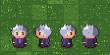<br><code>characters/ash</code></td><td align="center"><br><code>characters/bram</code></td><td align="center">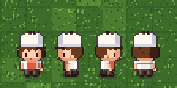<br><code>characters/clove</code></td></tr>
<tr><td align="center">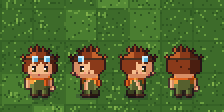<br><code>characters/cog</code></td><td align="center"><br><code>characters/farmer</code></td><td align="center">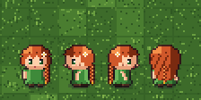<br><code>characters/fern</code></td><td align="center"><br><code>characters/grandpa</code></td></tr>
<tr><td align="center">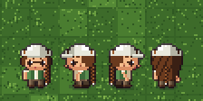<br><code>characters/ivy</code></td><td align="center">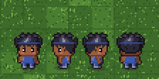<br><code>characters/kofi</code></td><td align="center"><br><code>characters/marina</code></td><td align="center">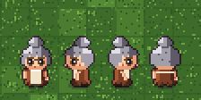<br><code>characters/nana</code></td></tr>
<tr><td align="center">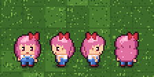<br><code>characters/pip</code></td><td align="center">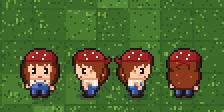<br><code>characters/rosa</code></td><td align="center">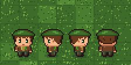<br><code>characters/rowan</code></td><td align="center"><br><code>characters/suki</code></td></tr>
<tr><td align="center"><br><code>characters/sunny</code></td><td align="center">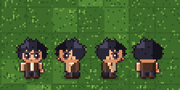<br><code>characters/theo</code></td><td align="center"><br><code>characters/wade</code></td><td align="center">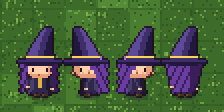<br><code>characters/wisteria</code></td></tr>
<tr><td align="center">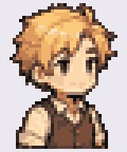<br><code>portraits/arlo</code></td><td align="center"><br><code>portraits/ash</code></td><td align="center">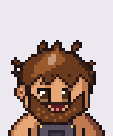<br><code>portraits/bram</code></td><td align="center">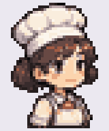<br><code>portraits/clove</code></td></tr>
<tr><td align="center"><br><code>portraits/cog</code></td><td align="center"><br><code>portraits/farmer</code></td><td align="center">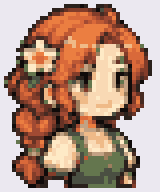<br><code>portraits/fern</code></td><td align="center">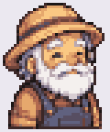<br><code>portraits/grandpa</code></td></tr>
<tr><td align="center">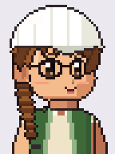<br><code>portraits/ivy</code></td><td align="center">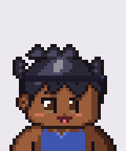<br><code>portraits/kofi</code></td><td align="center">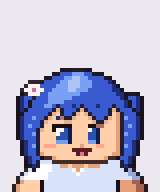<br><code>portraits/marina</code></td><td align="center"><br><code>portraits/nana</code></td></tr>
<tr><td align="center"><br><code>portraits/pip</code></td><td align="center"><br><code>portraits/rosa</code></td><td align="center"><br><code>portraits/rowan</code></td><td align="center">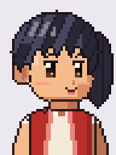<br><code>portraits/suki</code></td></tr>
<tr><td align="center">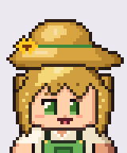<br><code>portraits/sunny</code></td><td align="center">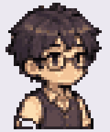<br><code>portraits/theo</code></td><td align="center">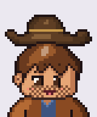<br><code>portraits/wade</code></td><td align="center"><br><code>portraits/wisteria</code></td></tr>
<tr><td align="center">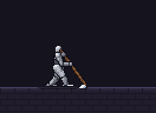<br><code>farming/hoe</code></td><td align="center">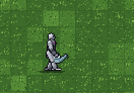<br><code>farming/water</code></td><td align="center"><br><code>crops/carrot</code></td><td align="center">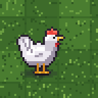<br><code>animals/chicken</code></td></tr>
</table>
<!-- /previews -->

## what's in it.

<!-- catalog -->
| category | effects | some of them |
|---|---|---|
| **characters** | 20 | arlo, ash, bram, clove, cog, farmer… |
| **portraits** | 20 | arlo portrait, ash portrait, bram portrait, clove portrait, cog portrait, farmer portrait… |
| **farming** | 4 | harvest, hoe, sow, water |
| **crops** | 26 | apples, bananas, barley, cabbages, carrot, cassava… |
| **trees** | 17 | bamboo tree, birch, burnt tree, crystal tree, dead tree, falling tree… |
| **animals** | 16 | bee, butterfly, cat, chicken, cow, crow… |
| **tiles** | 21 | berry bush, footbridge, cliff wall, cliff corner, dirt path, fallen log… |
| **buildings** | 14 | barn, chicken coop, farmhouse, deluxe farmhouse, expanded farmhouse, greenhouse… |
| **tools** | 12 | axe, bucket, fishing rod, hammer, lantern, pickaxe… |
| **objects** | 15 | barrel, beehive, bench, storage chest, cooking pot, crafting table… |
| **weather & seasons** | 5 | day and night, falling leaves, fireflies, rain, snow |
| **farm fx** | 10 | chopping impact, dust puff, footsteps, harvest sparkle, item pickup, mining impact… |
| **ui** | 15 | calendar, crafting menu, currency, tile cursor, day clock, dialogue box… |
| **island exploration** | 7 | gathering swing, metal ingot, island explorer, island shoreline, locked plot marker, ore deposit… |
| **resources** | 30 | amethyst deposit, bamboo, bone pile, cactus, clay deposit, coal ore… |
| **machines** | 45 | advanced furnace, alchemy station, anvil, assembly machine, auto collector, auto feeder… |
| **items** | 229 | animal feed, beeswax, butter, cheese, cream, egg… |
<!-- /catalog -->

The [asset index](ASSETS.md) links to every source file and available GIF preview. The [catalog](docs/CATALOG.md)
includes dimensions, timing, and descriptions.

## use one.

**In a browser game** (canvas, Phaser, PixiJS, Kaplay, three.js), use the code. No dependencies.

```js
import { createFrame, clearFrame, createFx, composite } from "farmfx";
import * as carrot from "farmfx/fx/crops/carrot";

const frame = createFrame(320, 180);                 // your game's pixel resolution
const img = new ImageData(320, 180);
const fx = createFx(carrot, { x: 160, y: 140 });    // also: flip, seed, palette...

function tick(dt) {
  fx.update(dt);
  clearFrame(frame);
  fx.draw(frame, "back");
  drawCharacters();
  fx.draw(frame, "front");
  composite(frame, img.data, backgroundColor);
  ctx.putImageData(img, 0, 0);                       // scale up with image-rendering: pixelated
}
```

Install from GitHub with `npm i github:duyhoang17930/farmfx`, or copy `src/core` and the assets you want.

**In any engine** (Godot, Unity, GameMaker, Defold, LÖVE, Bevy), use sprite sheets:

```bash
node tools/render.mjs crops/carrot --sheet
```

That writes a transparent PNG and Aseprite-style JSON with frame rectangles, durations, and a pixel pivot measured
from the top-left of a frame. Pixel-identical static clips use a single frame.

`node tools/sheets.mjs` exports the library to `sheets/`. Pass a category or asset ID to export a subset, or
`--out <directory>` to use a fresh destination. The `index.json` points to the default preview sheets and named
gameplay clips. Character and livestock clips use names such as `down-walk`, portraits use names such as
`happy-talk`, and farming clips use a facing such as `right` and play once. Crop stages `stage-0` through
`stage-4` are transparent overlays for your own soil.

The dirt path, stone path, pond, and dry tilled soil each export 16 cardinal masks named `connect-*`.
Open each `terrain.tsj` in Tiled and use its edge set with the Terrain Brush. The pond tileset retains its
water animation. Use nearest texture filtering for sheets that you import directly into an engine.

Crops play from seed to harvest by default. Set `stage` to 0 for seed, 1 for sprout, 2 for
young growth, 3 for maturing growth, or 4 for ripe. Where available, set `plot: false` to use your own ground tiles.
To render the crop previews and spritesheets together, run `node tools/render.mjs crops --gif --sheet --loops 1`.
The [preview directory](docs/preview/) contains GIFs named `crops-<id>.gif`.

Any asset takes a `palette`, so a summer field can turn autumn gold without touching its code:

```bash
node tools/render.mjs crops/wheat --gif --opts '{"palette": ["#2a1a08","#5c3a10","#a0701c","#d8a830","#f4d860","#fff4b0"]}'
```

## farm essentials.

| Assets | Options |
|---|---|
| `tiles/grass` | `season` is `spring`, `summer`, `autumn`, or `winter`. |
| `tiles/tilled-soil`, `tiles/pond` | `edges` or `banks` lists the exposed sides in `NESW` order. Use `""` for interior tiles. Soil `wet` goes from 0 to 1. |
| `tiles/fence` | Set `facing` to `east-west` or `north-south`. Set `gate: false` for plain rails, or choose an `open` value from 0 to 1 for a hinged gate. |
| `buildings/barn`, `buildings/chicken-coop` | Set `open` from 0 to 1 to position the door or hatch. |
| `animals/cow`, `animals/sheep` | Set `facing` to `down`, `left`, `right`, or `up`. Set `anim` to `idle`, `walk`, or `graze`. |
| `farming/sow`, `farming/harvest` | These use the same four facings and farmer looks as hoeing and watering. Set `plot: false` to draw over your map. |

Give the terrain tiles their map coordinates as `tileX` and `tileY` and use the same `seed` across a map
for continuous texture. A 16 px terrain tile goes at `x = 16 * tileX + 8`, `y = 16 * tileY + 12`.
The defaults for soil wetness, gate opening, and building doors or hatches cycle in previews. Set those
options explicitly to match your game's state.

## environment, equipment, wildlife, and UI.

Browse the [asset index](ASSETS.md) for source files and previews. Dirt and stone paths use `tileX` and `tileY` with
`edges` listing the sides that connect to another path tile. River tiles use `facing` and `tileOffset`
along the direction of flow. Set `water: false` on the bridge, duck, or fish to draw it over your own water.

The farmhouse has base, expanded, and deluxe sprites. Where available, use `open` and `active` to set an
object's door, lid, light, or cooking state. Pigs, goats, horses, cats, and dogs use the same `facing` and
`anim` options as cows and sheep. Small wildlife includes its facing in the catalog.

The UI assets draw the data supplied by your game, such as the selected slot, dialogue text, shop stock, or
health value. One-shot effects such as impacts and pickup notifications can be removed when `fx.done()`
returns true.

```bash
node tools/render.mjs buildings/farmhouse-deluxe --gif --sheet
node tools/render.mjs animals/horse --sheet --opts '{"facing":"down","anim":"walk"}'
node tools/render.mjs ui/energy-bar --sheet --opts '{"value":0.75}'
```

## island exploration

The exploration assets add an original player, an ore deposit and ingot, a locked plot sign, an unlock effect, and
47 shoreline layouts for a 16 px grid. See the [island scene](docs/preview/island-exploration.png) and the
[exploration catalog](docs/CATALOG.md#island-exploration).

```bash
node tools/sheets.mjs exploration --release --out sheets/exploration
node tools/exploration-audio.mjs sheets/exploration/audio
```

- Player sheets share a 48 × 48 frame and a foot pivot at `[24, 36]`. Each direction has idle, walk, axe, and
  pickaxe clips. Play an impact effect and the chop or mine sound at the swing's `contact` cue in the sheet metadata.
- Draw shoreline tiles over water. Pass the exposed cardinal sides as `edges` and any diagonally adjacent water as
  `corners` where both neighboring cardinal tiles are land. For example, `{ edges: "W", corners: ["NE"] }` matches
  the exported `edge-w-inside-ne` sheet. Reuse `tiles/pond` with `banks: ""` for water.
- Set `price` on the locked plot marker. For a static sheet with a different price, render it with
  `node tools/render.mjs exploration/locked-plot --sheet --opts '{"price":75}'`.
- Use `ingot` with FarmFX inventory and crafting UI, or use its standalone 16 × 16 sheet.
  The five WAVs are also in [audio/exploration](audio/exploration/).

## gatherable resources

The resource set includes 30 metal ores, gemstone clusters, mineral deposits, and wild gatherables. Most use a
32 × 32 canvas. Bamboo uses 32 × 48. See the [resource preview](docs/preview/resources.png) and
[asset names](docs/CATALOG.md#resources).

```bash
node tools/sheets.mjs resources --release --out sheets/resources
```

Use the exported pivot to place each sprite on the 16 px map grid. Static deposits export a single frame.
Gem glints, moving plants, and the meteorite embers export as loops.

## trees and regrowth

The tree collection includes woodland, tropical, winter, and fantasy trees. The [tree preview](docs/preview/tree-pack.png)
shows the new silhouettes, the chopping animation, and the regrowth stages.

```bash
node tools/sheets.mjs trees --release --out sheets/trees
```

- `trees/falling-tree` exports left and right one-shot clips. In code, set `flip: true` for a leftward fall.
  Replace the standing tree with the animation, place `tiles/stump` at the same map position on the `tip` cue,
  and sync the ground hit to the `impact` cue. Both cues are in the sheet metadata.
- `trees/tree-regrowth` exports four single-frame sheets. Set `stage` to `0` for a stump, `1` for a sapling,
  `2` for a young tree, or `3` for a mature maple. The default animation previews the sequence.

## machines and conveyors

The machine set includes 45 crafting stations, production machines, generators and transport tiles. See the
[machine preview](docs/preview/machine-pack.png) and [asset names](docs/CATALOG.md#machines).

```bash
node tools/sheets.mjs machines --release --out sheets/machines
```

The working loops play by default. Choose the `idle` sheet or pass `active: false` in code to show a stopped
machine. The anvil and bank are still sprites.

Conveyors are 16 × 16 tiles with their pivot at `[8, 12]`. The `facing` option takes `north`, `east`, `south`,
or `west`. It gives the direction of travel for straight belts, the incoming direction of travel for corners
and splitters, and the outgoing direction of travel for mergers. A corner also takes a `turn` of `left` or
`right`. Splitters send items to both sides, and mergers take items from both sides. Directional idle sheets
use the same ports as their active versions.

## raw inventory items

The [raw-item preview](docs/preview/raw-items.png) shows the 30 material icons at inventory scale. Each export
is a single transparent 16 × 16 frame with an `[8, 8]` pivot.

```bash
node tools/sheets.mjs items/raw --release --out sheets/raw-items
```

Pass item names such as `hardwood` or `copper-ore` to FarmFX's inventory, hotbar, crafting, shop, and pickup UI.
For standalone sprites in JavaScript, import from `farmfx/fx/items/raw/<name>`.

## processed inventory items

The [processed-item preview](docs/preview/processed-items.png) shows 25 icons for refined metals, building
materials, textiles, and ingredients. Each is a transparent 16 × 16 sprite with an `[8, 8]` pivot.

```bash
node tools/sheets.mjs items/processed --release --out sheets/processed-items
```

Pass IDs such as `steel-ingot` or `refined-oil` to the inventory UI, or import a standalone sprite from
`farmfx/fx/items/processed/<name>`.

## component inventory items

The [component preview](docs/preview/component-items.png) shows 20 fasteners, electronic parts, and machine parts.
Each sprite is a transparent 16 × 16 frame with an `[8, 8]` pivot.

```bash
node tools/sheets.mjs items/components --release --out sheets/component-items
```

The inventory UI accepts IDs such as `gear` and `circuit-board`. Import standalone sprites from
`farmfx/fx/items/components/<name>`.

## gem inventory items

The [gem preview](docs/preview/gem-items.png) shows 10 stones with distinct cuts and silhouettes. Each export
is a transparent 16 × 16 sprite with an `[8, 8]` pivot.

```bash
node tools/sheets.mjs items/gems --release --out sheets/gem-items
```

Use IDs such as `ruby` and `quartz` in the inventory UI, or import the sprite from
`farmfx/fx/items/gems/<name>`.

## produce inventory items

The [produce preview](docs/preview/produce-items.png) shows 30 fruit, vegetable, grain, and crop icons.
Each export is a transparent 16 × 16 sprite with an `[8, 8]` pivot.

```bash
node tools/sheets.mjs items/produce --release --out sheets/produce-items
```

Use IDs such as `banana`, `rice`, and `sweet-potato` in the inventory UI. Use `items/produce/cotton` for the
harvested cotton sprig. The short ID `cotton` selects the raw material icon. For standalone sprites, import
from `farmfx/fx/items/produce/<name>`.

## animal inventory items

The [animal item preview](docs/preview/animal-items.png) shows 14 icons for eggs, dairy, honey, meat, fish,
and feed. Each export is a transparent 16 × 16 sprite with an `[8, 8]` pivot.

```bash
node tools/sheets.mjs items/animal --release --out sheets/animal-items
```

Use IDs such as `golden-egg` and `animal-feed` in the inventory UI, or import the standalone sprite from
`farmfx/fx/items/animal/<name>`. Use `raw-fish` for the silver fish sprite and `fish` for the blue fish icon.

## food inventory items

The [food preview](docs/preview/food-items.png) shows 25 icons for cooked meals, baked goods, and drinks.
Each export is a transparent 16 × 16 sprite with an `[8, 8]` pivot.

```bash
node tools/sheets.mjs items/food --release --out sheets/food-items
```

Use IDs such as `bread`, `coffee`, and `mushroom-soup` in the inventory UI, or import a standalone sprite
from `farmfx/fx/items/food/<name>`.

## farmer actions.

The farming sprites include the farmer, tool, and chore effects. Choose a single facing and draw the action with
`createFx`. The default preview shows all four directions.

```js
import { createFx } from "farmfx";
import * as hoe from "farmfx/fx/farming/hoe";
const till = createFx(hoe, { x: 80, y: 140, facing: "right" });

// Each tick, with a cleared frame:
const before = till.t;
till.update(dt);
if (before < hoe.meta.events.contact && till.t >= hoe.meta.events.contact) {
  tillSoil(); // Your game's state update.
}
if (till.t < hoe.meta.duration) till.draw(frame);
```

Event times are in seconds from the start of the animation and also appear in exported
`meta.farmfx.events`. Hoe exposes `contact`, sow exposes `release`, harvest exposes `pull`, and water exposes
`pourStart` and `pourEnd`. Create a new effect instance to start another action.

## make your own.

```bash
node tools/new.mjs crops/pumpkin         # a working starting point (add --loop for a loop)
node tools/render.mjs crops/pumpkin      # records/crops/pumpkin/contact.png: look at it
node tools/check.mjs crops/pumpkin       # spills, seams, unseeded randomness, slow frames
node tools/index.mjs                     # update the registry, asset index, catalog and this README
node tools/preview.mjs crops/pumpkin     # its GIF in docs/preview and the grid at the top of this README
node tools/serve.mjs                     # the gallery, locally
```

Then go round: look at the contact sheet, fix the worst thing, render again. [docs/AUTHORING.md](docs/AUTHORING.md)
has the contract, the drawing API and the quality bar. `src/fx/_kit/` holds the shared helpers: `creature.js`
(outlined creatures in a grid, springs, hops), `sprite.js` (outlined sprites, shadows, bobs), `weather.js`,
`water.js`, `nature.js` and `ui.js`.

The `farmfx` Claude Code skill in `skills/farmfx` teaches Claude to find, use, export and make assets the same way.
Copy it into `~/.claude/skills/`, or add this repo as a plugin marketplace.

## license.

The MIT license covers the code and assets except for the reference-derived characters, portraits, and farming
animations. These remain part of the full local library and exports. Their redistribution rights are unverified.
See [NOTICE.md](NOTICE.md) for details.

`node tools/sheets.mjs --release` exports a separate set to `sheets/release/` without those assets.
`node tools/build-gallery.mjs --release` builds the corresponding public gallery in `dist/release/gallery/`.
The full source and npm package still include the reference artwork.
