# farmfx.

**<!-- count -->76<!-- /count --> pixel art assets and animations for farming games, every one a small piece of
code.** Crops that grow from seed to harvest, animals going about their day, tilled and watered soil, weather and
seasons, and a farmer who hoes, waters, sows and harvests. Play them live, recolor them for another season, drop
them into a browser game, or export sprite sheets for any engine.

Built on [pixelfx](https://github.com/patch-gg/pixelfx) by Patch: the same core, tools, gallery and acting
system, with a library made for farms instead of fights.

[catalog](docs/CATALOG.md) · [use one](#use-one) · [farmer actions](#farmer-actions) · [make your own](#make-your-own) ·
[license](#license)

<!-- previews -->
<table>
<tr><td align="center">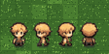<br><code>characters/arlo</code></td><td align="center"><br><code>characters/ash</code></td><td align="center">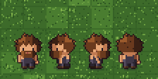<br><code>characters/bram</code></td><td align="center"><br><code>characters/clove</code></td></tr>
<tr><td align="center"><br><code>characters/cog</code></td><td align="center">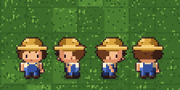<br><code>characters/farmer</code></td><td align="center"><br><code>characters/fern</code></td><td align="center">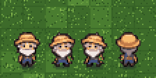<br><code>characters/grandpa</code></td></tr>
<tr><td align="center"><br><code>characters/ivy</code></td><td align="center"><br><code>characters/kofi</code></td><td align="center">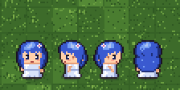<br><code>characters/marina</code></td><td align="center"><br><code>characters/nana</code></td></tr>
<tr><td align="center"><br><code>characters/pip</code></td><td align="center"><br><code>characters/rosa</code></td><td align="center"><br><code>characters/rowan</code></td><td align="center">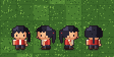<br><code>characters/suki</code></td></tr>
<tr><td align="center">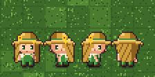<br><code>characters/sunny</code></td><td align="center"><br><code>characters/theo</code></td><td align="center">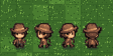<br><code>characters/wade</code></td><td align="center"><br><code>characters/wisteria</code></td></tr>
<tr><td align="center"><br><code>portraits/arlo</code></td><td align="center"><br><code>portraits/ash</code></td><td align="center"><br><code>portraits/bram</code></td><td align="center"><br><code>portraits/clove</code></td></tr>
<tr><td align="center">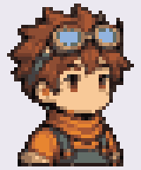<br><code>portraits/cog</code></td><td align="center">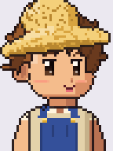<br><code>portraits/farmer</code></td><td align="center"><br><code>portraits/fern</code></td><td align="center"><br><code>portraits/grandpa</code></td></tr>
<tr><td align="center"><br><code>portraits/ivy</code></td><td align="center"><br><code>portraits/kofi</code></td><td align="center"><br><code>portraits/marina</code></td><td align="center"><br><code>portraits/nana</code></td></tr>
<tr><td align="center">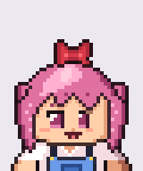<br><code>portraits/pip</code></td><td align="center">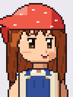<br><code>portraits/rosa</code></td><td align="center">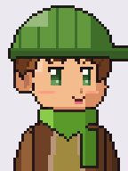<br><code>portraits/rowan</code></td><td align="center"><br><code>portraits/suki</code></td></tr>
<tr><td align="center"><br><code>portraits/sunny</code></td><td align="center"><br><code>portraits/theo</code></td><td align="center"><br><code>portraits/wade</code></td><td align="center"><br><code>portraits/wisteria</code></td></tr>
<tr><td align="center"><br><code>farming/hoe</code></td><td align="center"><br><code>farming/water</code></td><td align="center">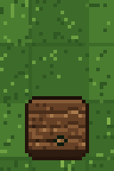<br><code>crops/carrot</code></td><td align="center"><br><code>animals/chicken</code></td></tr>
</table>
<!-- /previews -->

## what's in it.

<!-- catalog -->
| category | effects | some of them |
|---|---|---|
| **characters** | 20 | arlo, ash, bram, clove, cog, farmer… |
| **portraits** | 20 | arlo portrait, ash portrait, bram portrait, clove portrait, cog portrait, farmer portrait… |
| **farming** | 2 | hoe, water |
| **crops** | 26 | apples, bananas, barley, cabbages, carrot, cassava… |
| **animals** | 2 | chicken, cow |
| **tiles** | 4 | fence and gate, grass, pond, tilled soil |
| **buildings** | 2 | barn, chicken coop |
<!-- /catalog -->

Every asset is a file in `src/fx/<category>/<name>.js`. The [catalog](docs/CATALOG.md) lists them all.

## use one.

**In a browser game** (canvas, Phaser, PixiJS, Kaplay, three.js), use the code. No dependencies.

```js
import { createFrame, clearFrame, createFx, composite } from "farmfx";
import * as carrot from "farmfx/fx/crops/carrot";

const frame = createFrame(320, 180);                 // your game's pixel resolution
const img = new ImageData(320, 180);
const fx = createFx(carrot, { x: 160, y: 140 });    // also: flip, seed, palette...

function tick(dt) {
  fx.update(dt);
  clearFrame(frame);
  fx.draw(frame, "back");
  drawCharacters();
  fx.draw(frame, "front");
  composite(frame, img.data, backgroundColor);
  ctx.putImageData(img, 0, 0);                       // scale up with image-rendering: pixelated
}
```

Install from GitHub with `npm i github:duyhoang17930/farmfx`, or copy `src/core` and the assets you want.

**In any engine** (Godot, Unity, GameMaker, Defold, LÖVE, Bevy), use sprite sheets:

```bash
node tools/render.mjs crops/carrot --sheet
```

That writes a transparent PNG of every frame in a grid and an Aseprite-style JSON (frame rects, durations, and
`meta.farmfx` with fps, loop, columns and the pivot). `node tools/sheets.mjs` exports the whole library to `sheets/`.

Crops play from seed to harvest by default. Set `stage` to 0 for seed, 1 for sprout, 2 for
young growth, 3 for maturing growth, or 4 for ripe. Where available, set `plot: false` to use your own ground tiles.
To render the crop previews and spritesheets together, run `node tools/render.mjs crops --gif --sheet --loops 1`.
The [preview directory](docs/preview/) contains GIFs named `crops-<id>.gif`.

Any asset takes a `palette`, so a summer field can turn autumn gold without touching its code:

```bash
node tools/render.mjs crops/wheat --gif --opts '{"palette": ["#2a1a08","#5c3a10","#a0701c","#d8a830","#f4d860","#fff4b0"]}'
```

## farmer actions.

The `farming` category is acted out by the stock character from pixelfx: he winds up, swings the hoe, the soil
bursts, he recovers. Swap `createFx` for `createAct` to play the character too:

```js
import { createAct } from "farmfx";
import * as hoe from "farmfx/fx/farming/hoe";

const act = createAct(hoe, { x: 80, y: 140 });
// act.update(dt); act.draw(frame); act.shake gives a little camera shake on contact
```

Got your own farmer sprite? Read the timing from `hoe.act` (or `meta.farmfx.act` in a sprite sheet's JSON) and
start your own animation `windup` seconds before the effect.

## make your own.

```bash
node tools/new.mjs crops/pumpkin         # a working starting point (add --loop for a loop)
node tools/render.mjs crops/pumpkin      # records/crops/pumpkin/contact.png: look at it
node tools/check.mjs crops/pumpkin       # spills, seams, unseeded randomness, slow frames
node tools/index.mjs                     # update the registry, catalog and this README
node tools/preview.mjs crops/pumpkin     # its GIF in docs/preview and the grid at the top of this README
node tools/serve.mjs                     # the gallery, locally
```

Then go round: look at the contact sheet, fix the worst thing, render again. [docs/AUTHORING.md](docs/AUTHORING.md)
has the contract, the drawing API and the quality bar. `src/fx/_kit/` holds the shared helpers: `creature.js`
(outlined creatures in a grid, springs, hops), `sprite.js` (outlined sprites, shadows, bobs), `weather.js`,
`water.js`, `nature.js` and `ui.js`.

The `farmfx` Claude Code skill in `skills/farmfx` teaches Claude to find, use, export and make assets the same way.
Copy it into `~/.claude/skills/`, or add this repo as a plugin marketplace.

## license.

The MIT license covers the code and assets, except for the character reference art and its derivatives. See
[NOTICE.md](NOTICE.md) for the character art's status and the notices for pixelfx, Hugo Duprez's effects, and Hollow Crown.
